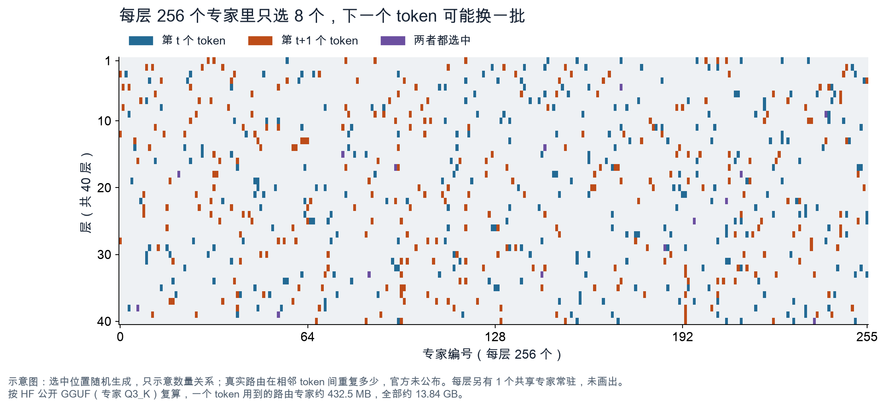
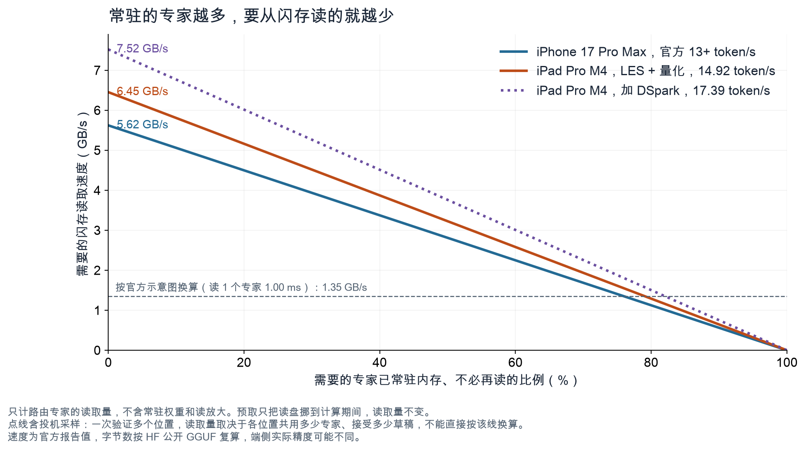
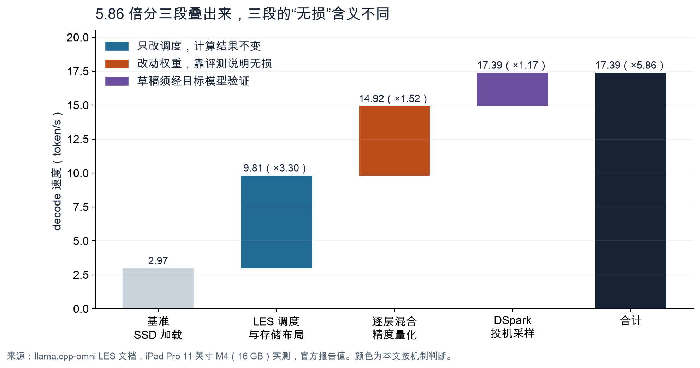

10 月 12 日，面壁智能开源了 MiniCPM-V 4.7，包括 35B-A3B 和 1B 两个规格。35B-A3B 是这个系列的第一个混合专家（MoE）模型，官方对它的描述是“首个端侧无损流畅运行的开源 MoE 模型”：在 iPhone 17 Pro Max 上只用 3 GB 内存，解码速度就能达到 13+ token/s。[模型指南][guide]

这句话里有四个说法。35B 是总参数量，3 GB 是内存占用，13 token/s 是生成速度，“无损”是说能力没有为速度打折。分开看都不新鲜，放在一起就需要解释了：按 Hugging Face 上公开的 GGUF 文件计算，光是专家权重就有 13.84 GB，是 3 GB 的四倍多。装不下的部分只能留在闪存里，那么速度从哪里来，“无损”又是怎样保证的？

这次发布公开的两份材料，正好能回答这些问题。一份是 OpenBMB 在 llama.cpp-omni 仓库里开源的端侧推理代码，除了调度逻辑，还有不少记录实测结论的注释。另一份是 GGUF 文件头，记着每个张量的形状和量化精度。下面用这两份材料把四个说法逐个拆开，看它们怎样同时成立、各自需要什么条件。读完之后，你应该能判断：手上的设备能否复现官方速度，“无损”在什么意义上成立，官方和 Qwen3.6 的对比又说明了什么。

需要先说明：我没有在手机上实测。文中的速度都是面壁报告的数字，字节数是我按公开文件复算的，复算只读取文件头，不下载权重。

## 激活 3B，为什么还要备着 35B

MoE 模型把每层的前馈网络拆成很多个小网络，称为专家（expert）。每个 token 经过一层时，由路由器（router）挑出其中几个参与计算，其余专家这一步不参与。

这样设计，模型的总参数可以很大，每个 token 的计算量却只取决于被选中的那几个专家。在服务器上，这意味着更快、更省钱。到了手机上，问题换成了另一个：计算量下来了，放权重的地方还是不够。

MiniCPM-V 4.7 35B-A3B 的语言部分有 40 层。每层有 256 个路由专家，每个 token 选 8 个，另有 1 个共享专家每次都参与。一个路由专家由三个 2048 × 512 的矩阵组成，约 315 万参数。[配置文件][config]

把 GGUF 文件头里各张量的元素数加起来，语言模型共有 34.66B 参数，其中 32.21B 在路由专家里，占九成以上。每个 token 实际参与计算的，是注意力、共享专家等非专家部分，加上 256 个里的 8 个专家，合计约 2.95B。这里没有算词嵌入，嵌入层每个 token 只取一行。“35B-A3B”这个名字和文件对得上。视觉编码器放在另一个 mmproj 文件里，不在这个数里。

麻烦在于，“激活”是按单个 token 算的。哪 8 个专家被选中，取决于当前 token 走到这一层时的状态，下一个 token 可能换成另一批，事先无法确定。所以虽然每一步只用到约 3B，32B 的专家权重都要随时能取到。

*图 1：示意图。选中的位置随机生成，只表示数量关系，不代表真实路由。按公开 GGUF 复算，一个 token 用到的路由专家约 432.5 MB，全部路由专家约 13.84 GB。*

面壁的模型指南提到了两条现成的路。一条是把专家权重留在闪存里，用到时再读进内存。模型能跑，但频繁等待读盘，生成会很慢。另一条是缩小可选的专家范围，比如对整段 prompt 固定一个专家子集。读盘少了，后面的 token 却可能选不到本来要选的专家，能力会下降。MiniCPM-V 4.7 走的是第一条路，要解决的是怎样让它不慢。[模型指南][guide]

## 每生成一个 token，要读多少数据

手机上有两种存储。内存读写快，但容量小，还要和系统、其他 App 共用。闪存就是存照片和 App 的那部分空间，容量大得多，读取却慢，每次读取还有固定的延迟。把放不进内存的专家留在闪存里，就得先算一笔账：每生成一个 token，要从闪存读出多少数据。

公开 GGUF 里的路由专家都是 Q3_K 精度，每 256 个权重占 110 字节，一个专家合 1.35 MB。一个 token 要经过 40 层，每层 8 个专家，共 320 个，合计 432.5 MB。

如果这些专家都不在内存里、每次现读，13 token/s 就要求闪存每秒读出 5.62 GB。iPad 上不含投机采样的 14.92 token/s 需要 6.45 GB/s，含投机采样的 17.39 token/s 需要 7.52 GB/s。

手机闪存实际能读多快，苹果没有公布。官方的 LES 示意图里倒有一组数字：读一个专家约 1.00 ms，算完一层约 1.15 ms。[LES 文档][les] 按每个专家 1.35 MB 换算，读速相当于每秒 1.35 GB。照这个读速，要达到 14.92 token/s，每个 token 需要的专家里至少要有 79% 已经留在内存里、不用再读。按同样的读速推算 iPhone 的 13 token/s，也要 76%。

*图 2：横轴是每个 token 需要的专家中，已经留在内存、不必再读的比例。速度为面壁报告值，字节数按公开 GGUF 复算。虚线按官方示意图“读 1 个专家约 1 ms”换算。点线含投机采样，一次验证多个位置，读取量不能直接按这条线换算。*

这个读速可能偏低。示意图按串行读取来画，开源代码却默认用 4 个线程并行读，实际吞吐可能更高。另外，手机上用的是不是这份公开文件，官方也没有说明。

再看内存。3 GB 里包含哪些部分，官方没有说明。假设手机版与公开 GGUF 精度相同，3 GB 又全部用来放权重。注意力、共享专家、词嵌入和输出层这些非专家权重约占 1.65 GB，剩下约 1.35 GB 最多放 997 个专家，约占全部 10240 个的 9.7%，平均每层 25 个。KV 缓存和运行时缓冲还要再占一些空间。好在 40 层里只有 10 层是全注意力，其余 30 层是线性注意力，KV 缓存随上下文增长得比较慢。[配置文件][config]

两个数字放在一起看：内存里最多只能放一成专家，每个 token 需要的专家却要有接近八成不用重新读取。官方没有公布相邻 token 之间重复使用专家的比例，这里的八成是我从速度和读速倒推出来的要求，没有测量过。要做到这一点，相邻 token 选用的专家必须大量重复，系统还要尽量把它们留在内存里。

## LES 提前读专家，选专家的仍是原路由器

面壁给出的方案叫 LES（Lookahead Expert Scheduling，前瞻专家调度）。思路写在文档里，具体做法要看代码。

在 llama.cpp-omni 的实现中，模型算到第 L 层、完成注意力之后，会取出这一层归一化后的隐状态，乘上第 L+1 层的路由权重，取得分最高的 8 个专家，作为对下一层的预测。[预测代码][code-predict] 预测器就是下一层自己的路由器，所以不需要额外训练。官方示意图上标着“依托残差流”。我的理解是，Transformer 相邻两层的隐状态通过残差连接传递，变化不大，所以提前用下一层的路由器打分，多数时候能猜中。示意图标注的命中率在 80% 以上。

第 L 层计算的同时，预测到的专家就开始从闪存读进内存。到了第 L+1 层，路由器用这一层真实的输入重新选出 8 个专家，参与计算的就是这 8 个。其中已经提前读好的直接拿来用，没预测到的当场读取，这一层就要等它。代码注释的原话是“Hits remap for free; misses still install on the critical path.”[调度代码][code-hit]

所以在这一步，参与计算的专家和权重与不开预测时完全一样，预测只决定哪些数据早一点读。面壁 10 月 15 日发布的英文新闻稿也写明，开启和关闭 LES，输出相同。[新闻稿][pr] 我核对的是开源实现，没有检查浮点累加顺序，也看不到官方 App 的代码。在这个范围内，“无损”的含义很清楚：计算内容没有变。

读盘部分的代码注释还记录了一条端侧实测结论：这条路径受带宽限制，decode 时间跟随读取的总字节数，而不是关键路径上等待的字节数。[读盘代码][code-io] 把读盘藏到计算后面，作用因此有限，速度主要看一共要读多少，这和上一节的估算一致。

减少读取总量要靠缓存。开启按层窗口后，开源实现给每层分配一段私有的槽位，里面的专家按 LRU 规则跨 token 保留，前面 token 用过的专家，后面的 token 可以直接复用。[窗口代码][code-window] 默认配置下，预读的专家也写进同一个窗口，和缓存一起按 LRU 管理。[共用窗口][code-unified] 预测结果还被用来指导淘汰，预计下一步要用的专家暂时不换出。[淘汰统计][code-evict] LES 的名字强调“前瞻”，从代码看，前瞻预测和缓存复用是一起起作用的。

示意图的数字还能用来做一个粗略的一致性检查。假设每层耗时等于 1.15 ms 的计算，加上每个没备好的专家 1.00 ms 的串行读取。基准方案是 2.97 token/s，折合每层 8.42 ms，扣掉计算还剩 7.27 ms，相当于 8 个专家几乎都要等着读。加上 LES 调度后是 9.81 token/s，每层 2.55 ms，扣掉计算剩 1.4 ms，平均每层只有约 1.4 个专家要等，约 82% 已经提前备好。新闻稿说 LES 在多数场景下能提前备好超过 80% 的所需专家，两者对得上。不过这个模型很粗：它假设提前读好的专家不占等待时间，而按前面那条注释，带宽受限时预读同样要消耗带宽。所以这组数字只能说明数量级一致，分不出预读和缓存各自贡献了多少。

## 5.86 倍是怎么叠出来的

LES 文档给了一张分阶段的速度表。测试设备是 iPad Pro 11 英寸 M4（16 GB），测试数据包括 MMMU、MathVista、CharXiv_reasoning_val、OCRBench、HumanEval、MBPP、AIME2025、AIME2026、Math500，以及一个内部文本对话 Arena 集。解码速度按生成 token 数除以解码总时长计算。[LES 文档][les]

*图 3：数据来自 LES 文档，均为面壁报告值。颜色是本文按各项优化的机制所做的区分。*

基准方案是专家从 SSD 按需加载、不开任何优化，速度 2.97 token/s。之后每加一项优化，“无损”的含义都不太一样。

第一段从 2.97 到 9.81 token/s，提速 3.30 倍，来自 LES 调度和读取优化，包括重排专家权重的存储布局、减少读取调用次数、直接写入 GPU 可见的内存。这些改动只影响数据什么时候读、怎么读，读到的还是同样的字节，计算不变。其中前瞻预测的部分，上一节已经对照代码确认过。

第二段从 9.81 到 14.92 token/s，提速 1.52 倍，来自逐层混合精度量化。每个专家的字节数变少，要读的总量就少了，在带宽受限的路径上效果很直接。但量化改动了权重，这里的“无损”只能理解为评测分数没有明显下降。文档列出了测试集，却没有给出量化前后的分数对照，基准方案用的是什么精度也没有说明。顺带一提，公开 GGUF 本身就是混合精度：路由专家全是 Q3_K，注意力和共享专家里有的层用 Q4_K，有的层用 Q6_K。手机上用的是不是同一套配置，官方没有说。

第三段从 14.92 到 17.39 token/s，提速 1.17 倍，来自 DSpark 投机采样。投机采样的思路是让一个小模型先猜后面几个 token，再由主模型一次检查多个位置，猜中的部分就省下了逐个生成的时间。这里的草稿模型有 5 层、约 3.9 亿参数，每次前向起草 15 个候选 token。[DSpark 模型卡][dspark-card] 在 llama.cpp-omni 的开源 server 里，验证时每个位置都由主模型的采样器采样，与草稿相同才继续往下接受，遇到第一个不同就停。[验证代码][code-accept] 输出的每个 token 都来自主模型，分布不变。贪心解码时，理论上与逐个生成的结果一致；随机采样时，同一个随机种子不一定得到逐字相同的输出。DSpark 论文里的置信度调度，只决定一次验证多少个位置。[DSpark 论文][dspark] 官方 App 的实现没有公开。

对专家放在闪存里的 MoE 来说，投机采样的账不如稠密模型划算。稠密模型一次验证多个位置，权重只读一遍；MoE 每个位置可能选中不同的专家，一次验证要读的专家更多。我推测，这是 DSpark 在这里只带来 1.17 倍的原因之一。

三段相乘，3.30 × 1.52 × 1.17 约等于 5.87，与 17.39 ÷ 2.97 得到的 5.86 只差在四舍五入。

MiniCPM-V 仓库的 README 写的是“5× speedup”，新闻稿写的是“approximately 5x”。[README][readme] 对照这张表，14.92 ÷ 2.97 ≈ 5.02，正好是前两段，不含 DSpark。两个数字都没错，只是统计范围不同。“无损”这个词在三段里也各有所指：第一段是计算内容相同，第二段是评测分数持平，第三段是输出分布不变。官方用一个词概括了三种保证，引用时最好分开写。

## 这些数字在什么条件下成立

先把两组官方数字的条件并排放在一起：

| | iPhone 17 Pro Max | iPad Pro 11 英寸 M4 |
| --- | --- | --- |
| 内存 | 3 GB，官方未说明包含哪些部分 | 设备内存 16 GB，模型占用未说明 |
| 速度 | 13+ token/s | 14.92 token/s（不含 DSpark），17.39 token/s（含 DSpark） |
| 是否开启 DSpark | 未说明 | 分别列出 |
| 测试数据 | 未说明 | 9 个公开数据集，加内部文本对话 Arena 集 |
| 速度口径 | 解码速度 | 生成 token 数除以解码总时长 |

iPhone 和 iPad 的数字来自不同设备，配置也未必相同。13 和 17.39 不宜直接比较，也不能拿 iPad 的分阶段倍数去推算 iPhone 上每项优化的贡献。

两组速度都只统计解码。对着一张图片提问，要先跑视觉编码，再做 prefill，这段等待不在 13 token/s 里。代码注释还提到，prefill 时一层要用上百个专家，窗口装不下，所以不走按层缓存。[窗口代码][code-window] 长 prompt 或大图要等多久才出第一个 token，官方没有给数字。

3 GB 的组成也没有公开。开源代码有一处注释提到，App 在 prefill 之前会卸载视觉投影模型（mmproj）。[代码注释][code-mmproj] 我据此推测，解码阶段的 3 GB 主要留给语言模型的权重和缓存，但这只是推测。还有一处要留意：DSpark 草稿模型的 F16 文件约 0.79 GB，如果 iPhone 上的 13+ token/s 开了 DSpark，这部分也要从 3 GB 里分出去。

“首个”要连同限定条件一起读。在端侧跑 MoE，此前已经有人做过：2023 年的 EdgeMoE 把专家权重放在外部存储里按需读取[EdgeMoE][edgemoe]；同年，苹果的 LLM in a flash 研究了从闪存按需加载权重[LLM in a flash][flash]；2024 年的 PowerInfer-2 在手机上以 11.68 token/s 运行了 47B 参数的 TurboSparse-Mixtral，用的是经过稀疏化改造的模型[PowerInfer-2][powerinfer2]。官方的说法同时限定了开源、MoE、端侧、无损、流畅这几个条件。同时满足这些条件，它是不是第一个，取决于“无损”和“流畅”怎么定义。我不替官方下这个结论，只把先行工作列在这里。

和 Qwen3.6 的对比，也要放回背景里看。官方的性能与效率前沿图显示，在 Instruct 模式下，35B-A3B 用更短的推理时间，拿到了比 Qwen3.6-35B-A3B 更高的综合分。图中的分数是 MMStar、MMMU-Pro、CharXiv_Reasoning、BLINK、MathVista 五个视觉基准的平均分，推理时间以秒计，没有注明硬件。[模型指南][guide] 这里的推理时间指完成评测的耗时，和端侧解码速度是两个指标。

模型卡在致谢里写明，语言基座来自 Qwen3.5 和 Qwen3.6。[模型卡][card] 对比两份配置文件，MiniCPM-V 4.7 35B-A3B 语言部分的层数、专家数、每个 token 选用的专家数、隐藏维度和注意力层排布，都和 Qwen3.6-35B-A3B 相同，只有词表大小略有差别。[Qwen3.6 配置][qwen] 也就是说，每个 token 在语言部分的计算量基本一致。我推测，推理时间的差别主要来自视觉部分：MiniCPM-V 4.7 在视觉编码器内部提前压缩视觉 token，默认压缩 16 倍；输出长度也可能不同。分数的差别，则来自视觉模块和后训练。这组对比说明，语言结构相同的两个模型，配上面壁的视觉方案和训练，在这五项视觉测试上更快、分数也更高。它比较的是同一种语言结构上的两套多模态方案。

## 想自己试，可以从哪里开始

先看文件大小。35B-A3B 的 mix_q3gud_im 版本约 15.5 GB，视觉投影 mmproj 约 1.12 GB，DSpark 草稿模型约 0.79 GB。[GGUF 仓库][gguf] 1B 的 Q4_K_M 版本只有 0.67 GB，普通笔记本就能先跑起来，Ollama 上的 openbmb/minicpm-v4.7 页面也列有 1b 标签。[Ollama][ollama]

如果电脑内存足够把 35B-A3B 整个装下，直接运行就行，用不到 LES。只有内存不够、要把专家放到磁盘上时，才需要 llama.cpp-omni 的这套机制。从源码看，它提供了这些开关：

- `tools/moe/experts.py extract` 把 GGUF 里的专家权重导出成按专家排列的文件。[导出脚本][code-experts-py]
- `--moe-experts` 指向导出的专家目录，`--moe-slot-bank` 设定常驻专家槽位数。[参数定义][code-args]
- 环境变量 `LLAMA_MOE_LOOKAHEAD_PREFETCH=1` 打开前瞻预测，`LLAMA_MOE_LOOKAHEAD_PREFETCH_DEPTH` 设定预测个数，默认 8。[预测开关][code-env] 按层的跨 token 窗口要另外设置 `LLAMA_MOE_DECODE_WINDOW`，不设就是关闭。[窗口开关][code-window-env]
- 运行结束时会打印 `lookahead-prefetch: armed=… hits=…`，括号里是预测命中率。[统计代码][code-report]
- 投机采样用 `--spec-type draft-dspark` 选择类型，用 `--spec-draft-model` 指定草稿模型。[参数定义][code-spec]

这些是源码里能看到的开关，我没有实际运行过。在开源实现里，跨层预测只在一次处理一个 token 时运行，DSpark 的验证批次一次处理多个位置，不走这条路径；按层缓存窗口则可以配置成也服务这些批次。这个仓库更新很快，上面的链接都固定在 commit 0b74404，自己动手前最好先核对最新代码。

## 我怎么看这次发布

拆到这里，MiniCPM-V 4.7 35B-A3B 的端侧方案可以这样概括：把闪存当作更慢的一级内存，用下一层现成的路由器做预测，再尽量让相邻 token 复用已经读进来的专家。这套设计不改模型结构，所以第一段加速的“无损”站得住。

我更看重的，是面壁把这套实现连同注释一起开源了。像“decode 时间跟随读取总字节数”这样的实测结论，直接决定了优化该往哪里使劲，也让外部开发者能看懂速度从哪里来。

官方的说法补几句说明，会清楚很多：

- “无损”在三段优化里分别指什么。
- “5×”不含 DSpark，加上是 5.86 倍。
- 3 GB 包含哪些部分，13 token/s 是否开启了 DSpark。

这些不影响成绩本身，但决定了开发者能否判断，自己的设备和任务能不能复现同样的结果。

我还想看到几组真机数据。命中率日志能说明窗口和预测各起了多大作用。不同存储容量的机型，闪存性能可能不同，速度值得分开测。带图片提问时，从提问到出第一个 token 要等多久，也决定了实际用起来的感受。有了这些，开发者就能拿“3 GB、13 token/s”去做选型判断了。

---

资料核对日期：2026 年 10 月 16 日。本文依据 MiniCPM-V 仓库（commit 52a0fab）、llama.cpp-omni 仓库（commit 0b74404）、Hugging Face 上的模型卡与 GGUF 文件头，以及面壁的英文新闻稿。速度和评测数字均为面壁报告，本文没有在设备上复现。图 1 是示意图，图 2 按公开 GGUF 的字节数复算，图 3 根据 LES 文档的数据重绘。源码结论只针对开源实现，官方 App 的代码没有公开。

主要资料：

- [MiniCPM-V 4.7 模型指南][guide] 与 [MiniCPM-V 仓库 README][readme]。
- [LES 前瞻专家调度文档][les]，含分阶段速度表与示意图。
- llama.cpp-omni 源码：[跨层预测][code-predict]、[命中与未命中][code-hit]、[读盘注释][code-io]、[按层窗口][code-window]、[投机解码验证][code-accept]。
- [MiniCPM-V-4.7-35B-A3B 模型卡][card]、[配置文件][config] 与 [GGUF 仓库][gguf]。
- [面壁英文新闻稿，2026 年 10 月 15 日][pr]。
- [DSpark 论文][dspark] 与 [DSpark 草稿模型卡][dspark-card]。
- 端侧 MoE 先行工作：[EdgeMoE][edgemoe]、[LLM in a flash][flash]、[PowerInfer-2][powerinfer2]。
- [Qwen3.6-35B-A3B 配置文件][qwen]。

[guide]: https://github.com/OpenBMB/MiniCPM-V/blob/52a0fabd6e4e85259c5b5971161e1403ad79487a/docs/minicpm_v4dot7_zh.md
[readme]: https://github.com/OpenBMB/MiniCPM-V/blob/52a0fabd6e4e85259c5b5971161e1403ad79487a/README.md
[les]: https://github.com/OpenBMB/llama.cpp-omni/blob/0b74404c9b3dfe2c6b11aebe0dd58fc23f133ee2/docs/les/lookahead-expert-scheduling.zh.md
[config]: https://huggingface.co/openbmb/MiniCPM-V-4.7-35B-A3B/blob/0bbda78419a0b505a58234574ff40b1c344a86fc/config.json
[card]: https://huggingface.co/openbmb/MiniCPM-V-4.7-35B-A3B
[gguf]: https://huggingface.co/openbmb/MiniCPM-V-4.7-35B-A3B-gguf
[dspark-card]: https://huggingface.co/openbmb/MiniCPM-V-4.7-35B-A3B-DSpark
[qwen]: https://huggingface.co/Qwen/Qwen3.6-35B-A3B/blob/995ad96eacd98c81ed38be0c5b274b04031597b0/config.json
[pr]: https://www.prnewswire.com/news-releases/modelbest-and-openbmb-launch-minicpm-v-4-7--bringing-a-35b-multimodal-moe-model-to-phones-and-tablets-with-about-3-gb-of-memory-302909881.html
[dspark]: https://arxiv.org/abs/2607.05147
[edgemoe]: https://arxiv.org/abs/2308.14352
[flash]: https://arxiv.org/abs/2312.11514
[powerinfer2]: https://arxiv.org/abs/2406.06282
[ollama]: https://ollama.com/openbmb/minicpm-v4.7
[code-predict]: https://github.com/OpenBMB/llama.cpp-omni/blob/0b74404c9b3dfe2c6b11aebe0dd58fc23f133ee2/src/models/qwen35moe.cpp#L455-L461
[code-hit]: https://github.com/OpenBMB/llama.cpp-omni/blob/0b74404c9b3dfe2c6b11aebe0dd58fc23f133ee2/src/llama-moe-slot.cpp#L117-L119
[code-io]: https://github.com/OpenBMB/llama.cpp-omni/blob/0b74404c9b3dfe2c6b11aebe0dd58fc23f133ee2/src/llama-moe-slot.cpp#L38-L44
[code-window]: https://github.com/OpenBMB/llama.cpp-omni/blob/0b74404c9b3dfe2c6b11aebe0dd58fc23f133ee2/src/llama-moe-slot.cpp#L1889-L1891
[code-unified]: https://github.com/OpenBMB/llama.cpp-omni/blob/0b74404c9b3dfe2c6b11aebe0dd58fc23f133ee2/src/llama-moe-slot.cpp#L1113-L1116
[code-evict]: https://github.com/OpenBMB/llama.cpp-omni/blob/0b74404c9b3dfe2c6b11aebe0dd58fc23f133ee2/src/llama-moe-slot.cpp#L168-L170
[code-accept]: https://github.com/OpenBMB/llama.cpp-omni/blob/0b74404c9b3dfe2c6b11aebe0dd58fc23f133ee2/common/sampling.cpp#L627-L637
[code-mmproj]: https://github.com/OpenBMB/llama.cpp-omni/blob/0b74404c9b3dfe2c6b11aebe0dd58fc23f133ee2/src/llama-moe-slot.h#L77-L79
[code-experts-py]: https://github.com/OpenBMB/llama.cpp-omni/blob/0b74404c9b3dfe2c6b11aebe0dd58fc23f133ee2/tools/moe/experts.py
[code-args]: https://github.com/OpenBMB/llama.cpp-omni/blob/0b74404c9b3dfe2c6b11aebe0dd58fc23f133ee2/common/arg.cpp#L2269-L2285
[code-env]: https://github.com/OpenBMB/llama.cpp-omni/blob/0b74404c9b3dfe2c6b11aebe0dd58fc23f133ee2/src/llama-model.cpp#L2190-L2202
[code-window-env]: https://github.com/OpenBMB/llama.cpp-omni/blob/0b74404c9b3dfe2c6b11aebe0dd58fc23f133ee2/src/llama-model.cpp#L2103-L2110
[code-report]: https://github.com/OpenBMB/llama.cpp-omni/blob/0b74404c9b3dfe2c6b11aebe0dd58fc23f133ee2/src/llama-moe-slot.cpp#L283-L294
[code-spec]: https://github.com/OpenBMB/llama.cpp-omni/blob/0b74404c9b3dfe2c6b11aebe0dd58fc23f133ee2/common/arg.cpp#L3735-L3746
